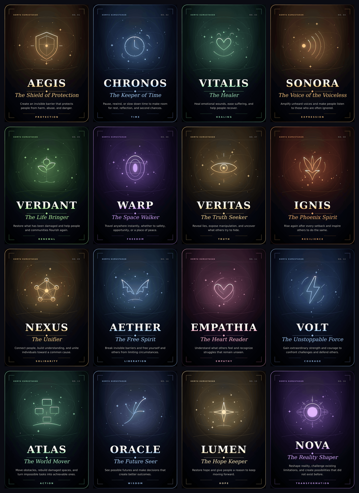

# KOMYU KUMUSTAHAN — What Would You Do If You Could?

> **▶ Play it now → [cssplscpsychbmangelo-afk.github.io/komyukomustahan](https://cssplscpsychbmangelo-afk.github.io/komyukomustahan/)**

A kumustahan activity in **10–15 minutes**. Participants answer three questions,
receive a superpower determined by the *combination* of all three answers, and
reflect on where they would use it — in their own lives, and in a society where
many of us are deprived of things we deserve.

It ends on the twist that matters: **you don't need superpowers to make a difference.**



- 3 questions × 4 choices = **64 combinations**
- **16 powers**, each with its own card, sigil, colour and description
- Nothing leaves the device — no accounts, no analytics, no network calls
- Works fully offline once loaded (installable as an app)

---

## Pages

| Page | What it is |
|---|---|
| **[index.html](index.html)** | The activity itself — opening, three questions, the awakening, the card, the reflection, the twist. |
| **[gallery.html](gallery.html)** | The full deck, plus a **power lookup** that resolves any of the 64 combinations. |
| **[guide.html](guide.html)** | Facilitator guide — run sheet, scripts, the mapping table, and notes on holding the room. *(Not linked from the top nav; bookmark it if you're running a session.)* |

---

## Run it locally

It's a static site — no build step, no dependencies at runtime.

```bash
npm start          # http://localhost:8000   (zero-dependency server)
```

or with anything else:

```bash
python3 -m http.server 8000
```

For a venue with no wifi: copy the folder to a laptop or USB stick and open
`index.html`. Everything is local, fonts included.

---

## How the power is determined

Assign `A = 0`, `B = 1`, `C = 2`, `D = 3`, then:

```
Power Index = 1 + ((5·Q1 + 3·Q2 + 7·Q3) mod 16)
```

The result is 1–16, and each number is one of the powers:

| # | Power | Domain | # | Power | Domain |
|---|---|---|---|---|---|
| 01 | AEGIS — The Shield of Protection | Protection | 09 | NEXUS — The Unifier | Solidarity |
| 02 | CHRONOS — The Keeper of Time | Time | 10 | AETHER — The Free Spirit | Liberation |
| 03 | VITALIS — The Healer | Healing | 11 | EMPATHIA — The Heart Reader | Empathy |
| 04 | SONORA — The Voice of the Voiceless | Expression | 12 | VOLT — The Unstoppable Force | Courage |
| 05 | VERDANT — The Life Bringer | Renewal | 13 | ATLAS — The World Mover | Action |
| 06 | WARP — The Space Walker | Freedom | 14 | ORACLE — The Future Seer | Wisdom |
| 07 | VERITAS — The Truth Seeker | Truth | 15 | LUMEN — The Hope Keeper | Hope |
| 08 | IGNIS — The Phoenix Spirit | Resilience | 16 | NOVA — The Reality Shaper | Transformation |

Because the weights sit on a modulo, the sixteen powers are not equally likely:
some sit on five combinations, others on three. That's a property of the formula,
not a bug. [guide.html](guide.html) prints the whole mapping.

---

## Publishing on GitHub Pages

The app is served **from the repository root**, so Pages works with no extra
configuration:

1. **Settings → Pages**
2. Source: **Deploy from a branch**
3. Branch: **`main`**, folder: **`/ (root)`** → Save

`.nojekyll` is committed so Pages serves the files as-is instead of running them
through Jekyll (without it, files and folders beginning with `_` are skipped).

Site URL: `https://<user>.github.io/<repo>/`

---

## The deck

Every card is generated as vector art — a line sigil over an elemental field,
with the name, epithet, description and domain. The same artwork powers the page,
the gallery, the downloaded card and the printable deck.

- **In the app** — inline SVG, tinted to the power's colour.
- **Download** — a self-contained SVG *and* a PNG with fonts embedded, so the card
  looks right when it lands in a chat or a slide.
- **Print** — [gallery.html](gallery.html) prints two cards per row with no page
  breaks inside a card.

Pre-rendered at 760×1064 in [`assets/deck/`](assets/deck);
[`assets/deck-all-powers.png`](assets/deck-all-powers.png) is the whole deck on one sheet.

---

## Project layout

```
index.html            the activity
gallery.html          the 16 powers + power lookup
guide.html            facilitator guide
superpowers.js        questions, the 16 powers, the reveal math  (data only)
sigils.js             one SVG glyph per power
cards.js              card renderer (pure string SVG)
export.js             standalone SVG/PNG export with embedded fonts
app.js                screens, answers, reveal, reflection, storage
styles.css            base + screens
card.css              the card object + print rules
sw.js                 offline cache
manifest.webmanifest  installable app
fonts/                self-hosted woff2 (no CDN)
icons/                app icons
assets/deck/          pre-rendered cards
serve.js              zero-dependency static server
test/smoke.js         drives the real pages in jsdom
test/restore.js       the "welcome back" path across two visits
test/a11y.js          axe-core audit of every screen
tools/render-deck.js  renders the deck + contact sheet
tools/sync-fonts.js   copies the needed fonts out of node_modules
```

Data, rendering and behaviour are deliberately separate: `superpowers.js` has no
DOM, `cards.js` has no state, and `app.js` only wires them together.

---

## Privacy

Answers and reflections are stored in `localStorage` under a single key
(`superpower.kumustahan.v1`) and are never transmitted — there is no network code
in `app.js` at all. **Clear my data** on the last screen removes everything. The
service worker caches only the app's own files.

---

## Development

```bash
npm install
npm test            # 81 checks: formula, card fitting, the participant flow,
                    # export, gallery, guide, and the return-visit restore path
npm run test:a11y   # axe-core audit; currently 0 violations across all 7 screens
npm run deck        # regenerate assets/deck — add --svg to keep the sources
npm run fonts       # re-copy fonts out of node_modules if the font set changes
```

The deck renderer decompresses the woff2 fonts to TTF first, because the
rasteriser can't read woff2 and would otherwise silently substitute its own fonts.

---

## Credits

Activity design, questions and closing text: the kumustahan activity as written.
Card art, code and facilitator tooling: built for this repository.

*Maybe we cannot stop time, heal every wound, rewrite reality, or protect everyone
from everything. But we can choose to listen, speak up, help someone, stand with
others, and make things a little better. Sometimes, the world doesn't need another
superhero. It needs ordinary people who refuse to be indifferent.*
